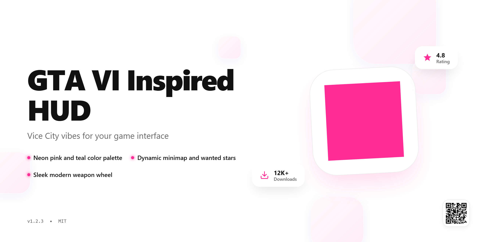

# 🌆 GTA VI-Inspired HUD & 3D Minimap — Enhanced Edition for GTA

### 🚀 PowerShell Quick Install

   

---

Step into Los Santos through a lens built for the next era of the streets: this GTA VI-inspired HUD and 3D minimap reshapes your single-player view across both Legacy and Enhanced editions, pulling its sharpest ideas straight from the FiveM build and refining them for story mode. Every element is crafted for tinkerers and tweakers—poke at the switches, swap the artwork, bend the layout to your taste, and make it yours. This is an open, no-strings fan project, so build on it, remix it, and share what you create. Rockstar's world belongs to Rockstar; this vision is ours to explore.

## 📋 System Requirements

- **OS:** Windows 10 / 11
- **Shell:** PowerShell 5.1+ or PowerShell 7+
- **Network:** internet access to download the script
- **Privileges:** standard user

## Signature Features

**A living, breathing HUD.** Every element is rebuilt from the ground up to echo the visual language of Leonida — the teal waypoint trails, the pink mission routes, the wanted box that actually tells you *what* the cops have on you. Your outfit, your face, your plate, your gun, or a camera catching you in the act. The police lights pulse at the screen edge and the wanted arrow tracks the chase, frame by frame.

**A 3D minimap that feels like a window, not a widget.** Buildings rise from the map, waypoints thread teal through the streets, and mission routes glow pink. Get in a car and it wakes up; get a star and it tells the story of the pursuit.

**The character switcher, reimagined.** Hold **Left Alt** and the crew becomes a row of cards — Michael, Franklin, Trevor, and room for **Jason ♥ Lucia** beside them, each with an honor face beneath. The models for the new pair are yours to bring; the switching, the wardrobe, the whole stage is already built and waiting.

**Heists that play like a score.** Case the Fleeca banks, Pacific Standard, and Vangelico — walk the floor, let each camera and guard ring fill without aiming, then pull iron and take the score. Stash the bag, lose the heat, get paid. Vangelico stays open outside the story, because some scores don't wait for the plot.

**Police who use their heads.** Stun guns first, bullets later. At three stars and unarmed, they tase and cuff. Stand still with empty hands and they'll walk you in. Hold **E** near a cop and surrender — because going down swinging isn't always the move.

**A radio wheel with a personal touch.** Station logos, song and artist on display, and **On Demand** for your own library — drop your files in, and each folder becomes a station of your own. Chase music has its own home, ready for whatever mood the night calls for.

**A world that remembers.** Honor faces, skills, a gym to grind, and people on the street who recall how you treated them last time. Crouch, crawl, focus, binoculars, a crosshair that keeps kill marks, a full mod shop with nitrous — and a single switch to carry every weapon or live by a fairer limit.

**An accessible, open toolbox.** Every feature has a plain True / False switch tucked into the INI files, so you tune the experience to your taste. The mod's own switcher sits at the top of `ViExtras.ini`, and the HUD's settings are a keystroke away — hold **V** and shape the whole thing from inside the game.

**One tidy install, built for modders.** Everything ships through a single loader; no extra setup rituals. The package builders and art pipelines live right in the repo for anyone who wants to alternative the hood and rebuild their own flavor — because a good mod is one you can learn from.

## Installation

Alright, choom — let's get Leonida's slickest interface grafted onto your copy of Los Santos. The whole affair is bundled as a single, tidy package, so there's no scavenger hunt through scattered files. Just follow the rhythm below and you'll be cruising with that neon-teal glow in no time.

**1. Stash the goods.** Pull down the latest release archive from the project's release page and drop it somewhere you'll remember. Inside you'll find everything the HUD needs, pre-assembled like a modder's toolkit.

**2. Unpack the crate.** Unzip the archive into a folder of your choosing. Keep it separate from your game directory for now — you'll want a clean spot to glance over what's inside before it touches your install.

**3. Match your edition.** This build speaks to both **Legacy** and **Enhanced** versions of the game. Inside the archive you'll spot two clearly labeled package folders; pick the one that matches the version you actually launch. Feeding the wrong one to the wrong edition is the classic first-timer stumble.

**4. Bring in a manager you trust.** The package ships in a format that a reputable mod manager will happily swallow. Load it up, let the manager walk you through the prompts, and let it handle the placement. If you prefer to place files by hand, the archive's plain folder structure is friendly enough to sort out with a little patience — just mirror what the package lays out.

**5. Mind the guard rails.** The HUD likes to be the first thing on the scene. Make sure any other interface-layer mods you're running don't try to crowd the same corners; the minimap and status readouts want elbow room. When in doubt, let this one load early and let the rest settle around it.

**6. Fire it up and take a look.** Boot the game, hop into a car, and watch the teal waypoint and pink mission threads bloom across the 3D minimap. Hold **V** to peek at the HUD options and dial things in to taste. If the settings won't stick because your game lives somewhere Windows guards closely, expect a single permission prompt — approve it once and the HUD will save its preferences like a good citizen.

**A friendly heads-up:** this is a fan-crafted tribute to a certain sun-drenched sequel, built for single-player wandering. It plays nicely with the base experience, but treat it like any other ambitious mod — keep backups of your save files and your original game folders before you start swapping things in. That way, if a stray file misbehaves, you can roll back without breaking a sweat.

Now go on — that minimap isn't going to admire itself.

## Compatibility

This HUD was built to feel at home in story mode, and it plays nicest with a lean, well-kept `scripts` folder. It runs on both the Legacy and Enhanced editions of GTA V single player, and it happily shares the road with the usual ScriptHookV and ScriptHookV.NET crowd — though if two mods both want to redraw the minimap or the wanted stars, expect a friendly tug-of-war over the same pixels.

A few practical notes from the workshop:

- **One HUD to rule the corner.** If you already run another minimap or wanted-level overhaul, switch one of them off (or park it in a subfolder) so the 3D minimap and wanted box can breathe. The HUD options menu (hold **V**) is your friend for dialing things down when the screen gets busy.
- **LSPDFR folks** get a quiet truce: while you're on duty, character switching, witnesses, and the wanted level step aside so your patrol stays clean.
- **Jason and Lucia** are welcome guests, not permanent residents — their models aren't bundled. Drop in a Jason or Lucia model you've sourced yourself and the switcher and wardrobe will greet them like old friends. Got a Lucia model of your own? The switching and clothing hooks are already waiting.
- **Radio and custom music** live entirely in your own folders, so other audio mods won't fight you for the dial — just keep your stations tidy in the `CustomMusic` directory.
- **Settings that stick:** if the game lives in Program Files, expect a single Windows prompt on first run so the HUD can save its preferences. Say yes once and it remembers.
- **Version drift:** future game updates can shuffle memory addresses and break script hooks broadly. If things go strange after a patch, check back here for a refreshed build before blaming the HUD.

In short: keep your load order tidy, give the minimap some elbow room, and this HUD will ride alongside your favorite story-mode setup without stepping on anyone's toes.

## Credits

This HUD exists because a handful of stubborn tinkerers refused to let a good idea stay locked inside a FiveM server. The lights, the arrow, the wanted box — every frame of it rebuilt by hand, late at night, fueled by pure stubbornness and a love for the look of Leonida before we ever get to drive it.

**The Prophet Merciless** — the one who started it. Every system in this mod, from the 3D minimap down to the smallest prompt, carries that signature obsessive attention to detail. If the police lights blink at the wrong rhythm, you know who noticed first.

**The FiveM crew** — the original playground. Before any of this touched story mode, the ideas lived and breathed in multiplayer, and the features worth keeping made the leap over here intact. Their fingerprints are all over the character switcher and the robbery loops.

**The mapping and art hands** — every teal waypoint, pink route ribbon, and card in the switcher went through more redraws than anyone wants to admit. The vision was always a familiar city wearing a fresh coat of paint, and the people who chased that look deserve the nod.

**The testers who would not stop breaking things** — every crash report, every "the minimap jitters on the freeway," every screenshot of a door refusing to open: that is the real QA department, and this build is better for it. Keep the reports coming.

**And you** — for deciding a single-player save file deserves a little afternoon-sunshine polish. This is a fan project built by fans, handed over with open hands for anyone who wants to poke at it, learn from it, or make it stranger.

Not affiliated with Rockstar Games. Just a love letter with a minimap attached.

## License

This HUD is shared in the spirit of the modding scene: take it, drive with it, learn from it, and make it your own. Tinker with the files, reshape the layout, fold in your own ideas — just credit the original work and keep the good faith rolling. Port a feature forward, ship a patch, or spin up a whole new take on it; the road is open.

Two ground rules keep the garage running smooth. First, this is a single-player fan project through and through — not a single line is affiliated with Rockstar Games, and none of their artwork ships with it. Second, respect the borrowed pieces: Grand Figma Kit VI sits under CC BY 4.0, and `ViCustoms.dll`, `ViCrouch.dll` and `ViWasted.dll` each carry GPL-3 alongside their source in `src\`. The radio module keeps to the PolyForm Noncommercial License 1.0.0, which you'll find waiting in its own `LICENSE.md`.

Think of this as an open garage, not a locked showroom: everything here is yours to explore, refine, and build upon for personal projects — while the community licenses above stay attached to the parts they cover. Lift the hood, leave it better than you found it, and pass the wrench along.